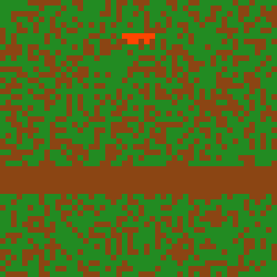

# Forest fire spread simulation

[](https://github.com/JackVermaak/ForestFireSpreadSim/actions/workflows/tests.yml)

An interactive wildfire simulator in Python, built on a stochastic cellular automaton. You start a fire by clicking a tree, then watch it spread with optional wind and a firebreak. A Monte Carlo forecast runs 50 possible futures and maps where the fire is most likely to reach.

Built as an individual project for an Advanced Modelling and Simulation course.



## Run it

```
pip install -r requirements.txt
python fire_spread_simulation.py
```

1. Click a tree to place the first fire.
2. Press **Start**. **Pause** and **Reset** do what they say.
3. Tick **Wind** and pick a direction, or tick **Firebreak** to clear a strip across the forest.
4. Press **Forecast Spread** to see the chance of each cell burning.

## How the model works

- The forest is a 50 × 50 grid. Each cell is empty ground, a tree or fire, and 60% of cells start as trees.
- Each step, a tree next to a burning cell (all 8 neighbours count) catches fire with a 50% chance. Burning cells burn out and become empty.
- With wind on, a tree directly downwind of a fire has a 90% chance of catching, and embers can jump one empty cell in the wind direction (50% chance).
- The firebreak clears rows 30 to 34.
- The forecast copies the current forest, runs it forward 50 times for up to 30 steps, and shows the share of runs in which each cell caught fire.

Set `SEED` near the top of `fire_spread_simulation.py` to a whole number to make runs repeatable.

## Code layout

| File | What it is |
| --- | --- |
| `fire_model.py` | The model: forest creation, the `step()` rules, `run()` and the Monte Carlo `forecast()`. No plotting, so it can be imported on its own. |
| `fire_spread_simulation.py` | The Matplotlib interface (`FireApp`), built on the model. |
| `tests/test_model.py` | pytest tests, all seeded. |

Using the model without the interface:

```python
import fire_model as fm

rng = fm.make_rng(42)
forest = fm.create_forest(size=200, rng=rng, firebreak_rows=range(120, 125))
forest[10, 100] = fm.FIRE
chance = fm.forecast(forest, trials=100, rng=rng, wind=fm.WIND["North"])
```

## Speed

`step()` updates the whole grid at once with NumPy: the eight neighbour checks, the wind boost
and the ember jump are each one shifted-array comparison, instead of a Python loop over every cell.
Measured on an Apple M1 Max with wind on:

| Grid | Old (cell loop) | New (vectorised) | Speed-up |
| --- | --- | --- | --- |
| 50 × 50 | 15.3 ms per step | 0.12 ms | about 130× |
| 200 × 200 | 218 ms per step | 0.61 ms | about 360× |

A 50-run forecast now takes a fraction of a second, and grids of a few hundred cells across stay
interactive. Over 150 seeded fires each, the old and new versions burn the same share of the
forest to within sampling noise.

## Tests

```
pip install pytest
python -m pytest
```

The tests check, among other things, that a fire cannot cross a full-width firebreak without wind
(or a five-row one with it), that embers jump a one-cell gap only downwind, that the wind boost
lifts the catch rate from 50 % to 90 %, and that forecast values are probabilities between 0 and 1.
They run on every push with GitHub Actions.

## Limits

- Wind has four directions and a fixed strength.
- Terrain, fuel types and moisture aren't modelled.

The full write-up is in [docs/forest_fire_sim_documentation.pdf](docs/forest_fire_sim_documentation.pdf). There's also a short page on [jackvermaak.com](https://jackvermaak.com/projects/fire-simulation.html).
